# HaloWatch

**English** · [Русский](README.ru.md)

A watch firmware for the round **Waveshare ESP32-S3-Touch-AMOLED-1.75C** (466 × 466 AMOLED, touch, speaker,
battery). The look and the motion are modeled on **Wear OS**, using only open sources (see [Credits](#credits)).

It runs on **Halo**, a small UI library written from scratch for this board: its own display driver, its own touch
driver, its own drawing. No LVGL, no Arduino_GFX. Animations run at **60 fps with no dropped frames and no tearing**,
and when nothing moves, no frames are drawn at all. Left alone, it dims to an **Always On** clock and sleeps until you
touch it, press a button or pick it up.

<p align="center"><a href="https://www.youtube.com/watch?v=7rBIQl6EG08"></a><br><sub>▶ Video review on YouTube</sub></p>

| Watch face | Weather | Weather, page 2 | Gallery |
| :---: | :---: | :---: | :---: |
| 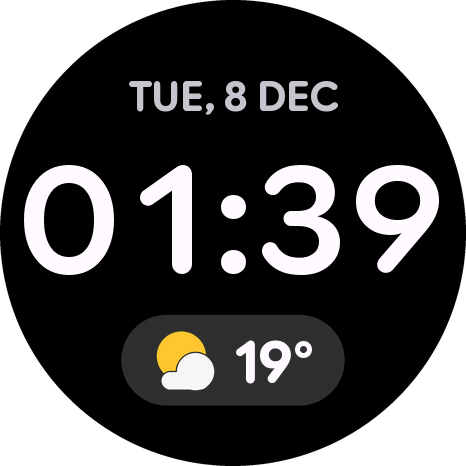 | 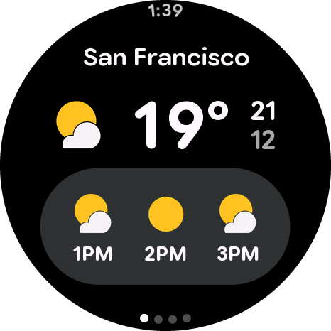 | 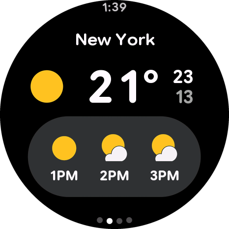 | 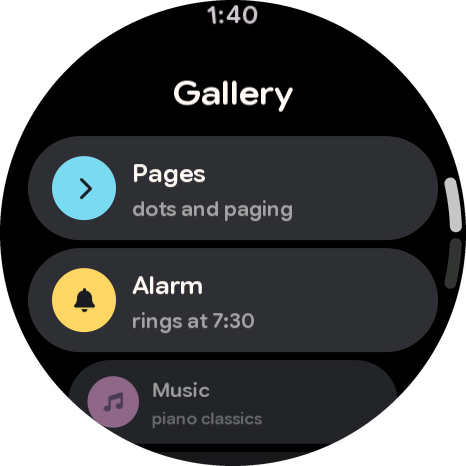 |
| **Gallery, end** | **Pages** | **Player** | **Volume** |
| 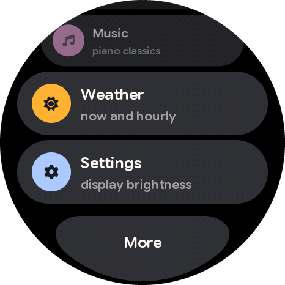 | 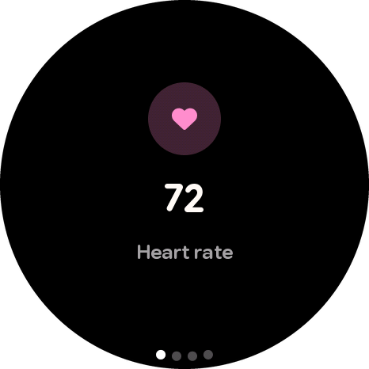 | 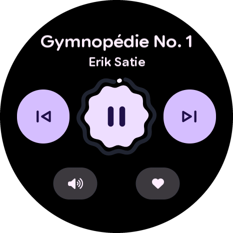 | 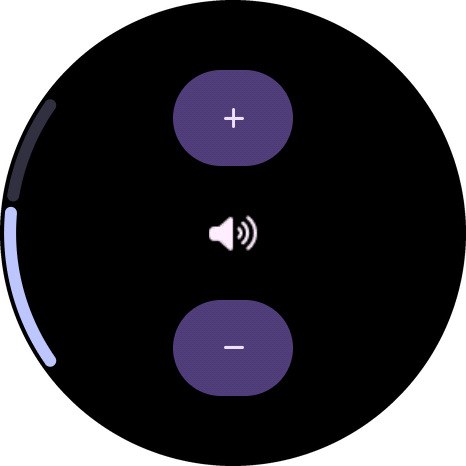 |
| **Settings** | **Display** | **Battery** | **Locked** |
| 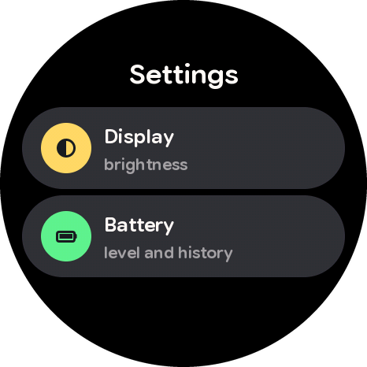 | 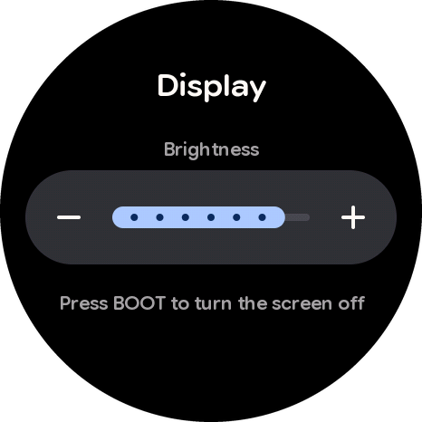 | 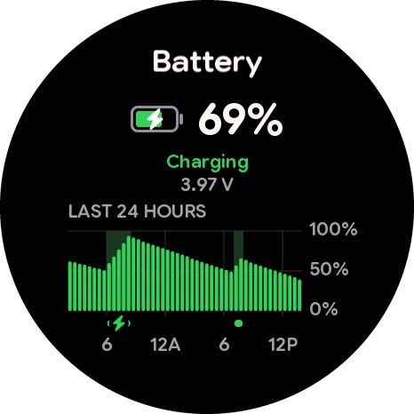 | 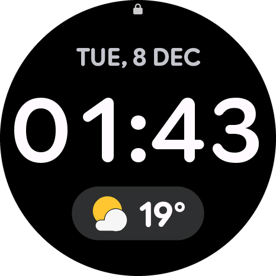 |
| **Always On** | | | |
| 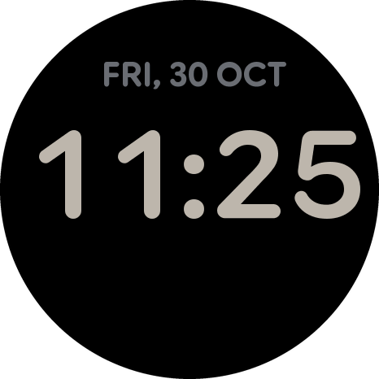 | | | |

## What it does

- **Watch face**: digits and letters change with a rolling animation, like a mechanical counter. Tap the weather
  chip to open the weather.
- **Weather** for four cities, with page dots.
- **Gallery** of cards, as on a Pixel Watch: cards shrink near the edge of the circle, the list flies on with
  inertia and bounces back; at the end, an edge button.
- **Transitions**: Fade between the face and the gallery, the Android 16 transition into screens, swipe back from
  the left edge that follows the finger.
- **Player** with real music (four 20-second public-domain excerpts), a wavy play button and a progress ring.
- **Settings**: a brightness slider (remembered after a restart) and a battery screen with a 24-hour chart.
- **Always On**: after 15 s without touches or motion the screen fades out and only the face's date and clock stay,
  dimmed, on black. The board sleeps and wakes once a minute for a moment to change the digits (and shift them a few
  pixels, so the AMOLED does not burn in). **Touch the screen, press BOOT or pick the watch up** — you are back where
  you were, at full brightness, at once; the waking touch presses nothing. On our battery Always On used about
  **10 % in 8 hours** (100 % → 90 % overnight).
- **Buttons**: BOOT turns the screen fully off and puts the board to sleep (a touch, BOOT or picking it up wakes it —
  picking up only after it has lain still, so turning it off in your hand does not wake it again); PWR locks the touch
  screen (a lock icon appears at the top), a long press unlocks.

There is no Wi-Fi in this version and the board has no separate real-time clock chip (see [The board](#the-board)),
so the watch starts at a **random date and
time** and keeps going from there. The weather and health numbers are demo data.

### Gestures

| Where | Gesture | What happens |
| --- | --- | --- |
| Watch face | swipe up | gallery |
| Watch face | tap the weather chip | weather (swipe up from the bottom edge to go back) |
| Gallery | swipe down from the top edge | watch face |
| Any screen | swipe right from the left edge | back |
| Any screen | swipe up from the bottom edge | watch face |
| Always On or dark screen | touch, BOOT or pick the watch up | back where you were, at once |

## The board

<p align="center">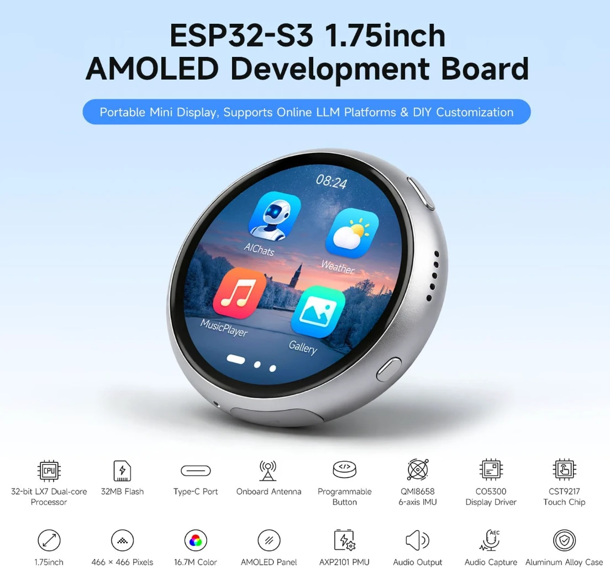<br><sub>Image: Waveshare</sub></p>

**[Waveshare ESP32-S3-Touch-AMOLED-1.75C](https://www.waveshare.com/esp32-s3-touch-amoled-1.75c.htm)** is a small
round development board in an aluminum case: a 1.75-inch AMOLED touch screen, sound, a motion sensor and a battery
connector. Documentation — [docs.waveshare.com](https://docs.waveshare.com/ESP32-S3-Touch-AMOLED-1.75C), examples
and schematics — [GitHub](https://github.com/waveshareteam/ESP32-S3-Touch-AMOLED-1.75C).

| Part | What it is | In HaloWatch |
| --- | --- | --- |
| Processor | ESP32-S3R8: two Xtensa LX7 cores up to 240 MHz, 512 KB SRAM, 8 MB PSRAM | both cores draw every frame |
| Flash | 32 MB | firmware and a partition for music |
| Radio | Wi-Fi 2.4 GHz (802.11 b/g/n), Bluetooth 5 LE, onboard antenna | not used in this version |
| Screen | 1.75" AMOLED, 466 × 466, 16.7M colors, 700 cd/m², CO5300 driver over QSPI, TE signal | own driver |
| Touch | capacitive, CST9217 (I2C) | own driver |
| Motion sensor | QMI8658, 6 axes: accelerometer and gyroscope | wakes the watch when you pick it up (its wake-on-motion pin, INT1, goes to GPIO21) |
| Power | AXP2101 power chip, connector for a 3.7 V Li-ion battery (MX1.25), charging over USB | battery screen, PWR button |
| Sound | ES8311 codec with a speaker; ES7210 with two microphones and echo cancellation | the player (ES8311) |
| Buttons | PWR and BOOT, both programmable | lock; screen off and sleep |
| USB | Type-C, the ESP32-S3's own USB: flashing and a serial port | flashing, USB commands |
| Case | one-piece CNC aluminum, anodized, lanyard holes | — |

**About the RTC.** The introduction of Waveshare's documentation mentions an RTC, but the board has **no separate
real-time clock chip**. There is none on the [schematic](https://github.com/waveshareteam/ESP32-S3-Touch-AMOLED-1.75C/blob/main/hardware/schematic/ESP32-S3-Touch-AMOLED-1.75C-schematic.pdf), and an I2C scan of the board finds only `0x18`
ES8311, `0x34` AXP2101, `0x40` ES7210, `0x5A` CST9217 and `0x6B` QMI8658 (plus an unidentified `0x7E`, an address
reserved by the I2C standard) — no RTC address such as `0x51` or `0x68`. The time is kept by the ESP32-S3 itself, with
its built-in RTC timer, only while the board has power; after power-off it is lost. There is no microSD slot either.

## How it works

- **Only what changed is drawn.** Every element knows where it was and where it is now; only those parts of the
  screen are redrawn and sent. A new minute on the face is 1–2 % of the screen, 1–4 ms.
- **Own display driver.** The screen is drawn in bands of 16 rows. While one band goes out over QSPI by DMA, the next
  one is already being drawn.
- **Both cores draw each band**, left and right halves, with a moving border so they finish together.
- **No tearing.** The display reports each refresh with its TE signal; a light frame is sent ahead of the refresh,
  a heavy one right behind it.
- **Own touch driver.** The touch chip raises a pin on every report; a task reads it and keeps the finger's speed,
  so lists fly on and transitions decide whether to finish.
- **Steady motion.** The animation clock is the moment the screen will show the frame (taken from the TE signal,
  like Android's Choreographer), so every frame moves by the same step; and a moving screen does not switch between
  "ahead of the refresh" and "behind it" mid-way — that used to show a frame twice or drop one.
- **The finger, resampled.** The touch chip reports ~100 times a second, out of step with the 60 Hz screen. The
  finger is taken at a fixed moment before each frame is shown, between two reports, as Android does: content under
  the finger moves by even steps (on a real drag: uneven by 0.56 px instead of 3.2 px).
- **Light sleep.** Memory and program stay, so waking takes ~20–35 ms to a picture — no boot. The AMOLED keeps the
  Always On picture by itself while the processor sleeps. Time in sleep is counted by the fast RC oscillator / 256:
  the default slow one ran 0.5 % fast (half a minute per hour asleep), this one 0.03–0.06 %.
- **Springs, as in Wear OS.** Stiffness, damping, durations and how cards shrink at the edge come from the open
  source code of Compose for Wear OS. A spring is solved exactly, so a bounce looks the same at any frame rate.

| What | Frame time | Missed frames |
| --- | --- | --- |
| Idle | no frames | — |
| New minute on the face | 1–4 ms | 0 |
| Paging | median 3.3 ms | 0 |
| Scrolling the card list | median 9–11 ms | 0 |
| Player, while music plays | median 5.7 ms | 0 |
| Always On | one frame a minute, the rest asleep | — |

The frame budget is 16.7 ms.

## Install

### Ready file (easiest)

Download **`HaloWatch-v1.1-full.bin`** from [Releases](../../releases) — it holds the firmware and the music. Write it
to the board at address **0x0**.

**In the browser** (Chrome or Edge, any OS): open [ESP Tool](https://espressif.github.io/esptool-js/), connect the
board by USB, press **Connect**, set the flash address to `0x0`, choose the file and press **Program**.

**From the command line** (macOS, Linux, Windows; needs Python 3):

```bash
pip install esptool
esptool --chip esp32s3 write-flash 0x0 HaloWatch-v1.1-full.bin
```

esptool finds the board itself; if not, add `--port` with the board's port: `/dev/cu.usbmodem101` on macOS,
`/dev/ttyACM0` on Linux, `COM5` on Windows. On Linux you may need to add yourself to the `dialout` group first.

If the board doesn't connect: hold **BOOT**, plug in the cable, release **BOOT**, and try again. After writing, press
**PWR** or replug the cable.

### From source

You need [arduino-cli](https://arduino.github.io/arduino-cli/latest/installation/) (macOS: `brew install arduino-cli`)
and the ESP32 core **3.3.11**:

```bash
arduino-cli config add board_manager.additional_urls https://espressif.github.io/arduino-esp32/package_esp32_index.json
arduino-cli core update-index
arduino-cli core install esp32:esp32@3.3.11
```

Build and upload (replace the port with yours):

```bash
arduino-cli compile --upload -p /dev/cu.usbmodem101 --libraries libraries --fqbn "esp32:esp32:esp32s3:FlashSize=32M,PSRAM=opi,FlashMode=qio,PartitionScheme=app5M_fat24M_32MB,USBMode=hwcdc,CDCOnBoot=cdc" HaloWatch
```

Music for the player is written once, into its own flash partition (needs `ffmpeg` and `esptool`):

```bash
python3 tools/halo_music.py HaloWatch --flash --port /dev/cu.usbmodem101
```

Your own music works the same way: put a file into `HaloWatch/assets/music/` (any format ffmpeg reads) and add a
line to `HaloWatch/assets/music.conf`.

Fonts, icons and images are already built into `HaloWatch/src/halo_assets.*`. To change them, edit
`HaloWatch/assets/halo.conf` and run `python3 tools/halo_assets.py HaloWatch` (needs `pip install numpy pillow`; the
fonts are downloaded from their original repositories on first run).

### USB commands

The firmware listens on the USB serial port (115200). A few commands: `face`, `face off`, `open 0`…`5`, `back`,
`tap X Y`, `swipe up|down|left|right [edge]`, `pwr`, `pwr long`, `boot`, `batdemo`, `log`, `sys`; Always On:
`sleep`, `wake`, `aod on|off`, `idle N` (seconds, 0 — never).

On USB power the watch does not really sleep (the USB port would go quiet and the board could not be flashed): it
dims and wakes the same way, the processor just keeps running. On battery it really sleeps. `usb on` makes it sleep on
USB too — then wake it by hand before flashing.

## Project layout

| Folder | What's inside |
| --- | --- |
| `HaloWatch/` | The firmware: `HaloWatch.ino` (gallery, pages), `face.h`, `weather.h`, `player.h`, `music.h`, `settings.h`, `display.h`, `battery.h`, `power.h` (Always On and sleep); `assets/` — fonts, icons and music sources |
| `libraries/Halo/` | The Halo library: display and touch drivers, frame engine, drawing, springs, lists, screen transitions, audio, sleep and wake-up |
| `tools/` | `halo_assets.py` — fonts, icons and images for Halo; `halo_music.py` — music for the player |

## Versions

| Version | What's new |
| --- | --- |
| [1.1](../../releases/tag/v1.1) | Always On and sleep (wake by touch, BOOT or picking the watch up), steadier motion, smoother dragging, BOOT puts the board to sleep |
| [1.0](../../releases/tag/v1.0) | First release |

## Credits

**The interface is modeled on Wear OS, using only open sources.** The code is written from scratch. No firmware or
app was decompiled or reverse-engineered, and no code was taken from GPL projects. The motion numbers and ideas
come from:

| Source | License | What we used |
| --- | --- | --- |
| [androidx](https://github.com/androidx/androidx) — Compose for Wear OS | Apache 2.0 | spring stiffness and damping, durations and easing curves, how cards shrink at the edge, swipe back, indicators |
| [Horologist](https://github.com/google/horologist) | Apache 2.0 | player: sizes, the wavy button, the progress ring, icon animation timing |
| [wear-os-samples](https://github.com/android/wear-os-samples) | Apache 2.0 | how a screen is put together from components |
| [PebbleOS](https://github.com/coredevices/PebbleOS) | Apache 2.0 | screen transition techniques on a microcontroller |
| [Material Design 3](https://m3.material.io) and Wear OS design guidelines | public guidelines | overall style: colors, corner radii, sizes |

Third-party parts included in this repository:

| What | Author | License |
| --- | --- | --- |
| Google Sans Flex font (glyphs rendered into `HaloWatch/src/halo_assets.cpp`) | Google | [SIL OFL 1.1](https://openfontlicense.org) |
| Font Awesome Free icons (rendered into `HaloWatch/src/halo_assets.cpp`) | Fonticons, Inc. | icons [CC BY 4.0](https://fontawesome.com/license/free) |
| ES8311 codec register sequence (`libraries/Halo/src/halo_audio.cpp`) | based on Espressif's es8311 driver | Apache 2.0 |
| Board pins and display start-up sequence | based on [Waveshare examples](https://github.com/waveshareteam/ESP32-S3-Touch-AMOLED-1.75C) | Apache 2.0 |
| Board picture (`docs/board.webp`) | Waveshare, from the [product page](https://www.waveshare.com/esp32-s3-touch-amoled-1.75c.htm) | shown only to identify the board |

Music — 20-second excerpts of [Musopen](https://musopen.org) recordings from Wikimedia Commons:

| Piece | Performer | License |
| --- | --- | --- |
| [Erik Satie — Gymnopédie No. 1](https://commons.wikimedia.org/wiki/File:Erik_Satie_-_gymnopedies_-_la_1_ere._lent_et_douloureux.ogg) | Robin Alciatore | public domain |
| [J. S. Bach — Goldberg Variations, Aria](https://commons.wikimedia.org/wiki/File:Bach,_Goldberg_Variations,_Aria_(Musopen_version).ogg) | Shelley Katz | CC0 1.0 |
| [L. van Beethoven — Sonata No. 8 "Pathétique", II. Adagio cantabile](https://commons.wikimedia.org/wiki/File:Beethoven,_Sonata_No._8_in_C_Minor_Pathetique,_Op._13_-_II._Adagio_cantabile.ogg) | Paul Pitman | CC0 1.0 |
| [F. Chopin — Nocturne Op. 15 No. 1](https://commons.wikimedia.org/wiki/File:Chopin_-_Nocturne_Op._15_no._1_in_F_major.ogg) | Luke Faulkner | CC0 1.0 |

## License

The code of this repository is under the **MIT** license ([LICENSE](LICENSE)): you may use it for anything,
including commercial projects. The third-party parts above keep their own licenses.

This is an independent project. It is not affiliated with or endorsed by Google, Espressif or Waveshare. Wear OS,
Pixel Watch, Android and Material Design are trademarks of Google LLC; ESP32 is a trademark of Espressif Systems; Waveshare is a trademark of Waveshare Electronics;
the names are used only to describe what the interface looks like and what it runs on.
