# HaloWatch

[English](README.md) · **Русский**

Прошивка часов для круглой платы **Waveshare ESP32-S3-Touch-AMOLED-1.75C** (AMOLED 466 × 466, тач, динамик,
батарея). Внешний вид и движение сделаны **по подобию Wear OS, только по открытым источникам** (список — в разделе
[Источники](#источники)).

Работает на **Halo** — небольшой библиотеке интерфейса, написанной с нуля для этой платы: свой драйвер экрана, свой
драйвер тача, своё рисование. Без LVGL и Arduino_GFX. Анимации идут на **60 кадрах в секунду без пропусков и без
разрывов картинки**, а когда ничего не движется, кадры не рисуются вовсе. Если часы не трогать, они гаснут до
тусклых часов **Always On** и спят, пока их не коснутся, не нажмут кнопку или не возьмут в руки.

<p align="center"><a href="https://www.youtube.com/watch?v=7rBIQl6EG08"></a><br><sub>▶ Видеообзор на YouTube</sub></p>

| Циферблат | Погода | Погода, стр. 2 | Галерея |
| :---: | :---: | :---: | :---: |
| 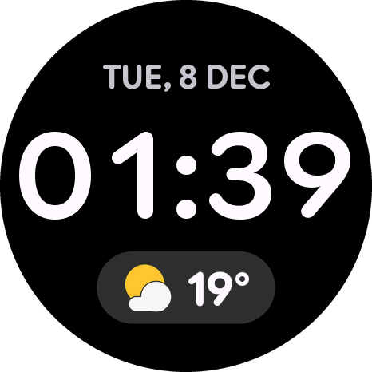 | 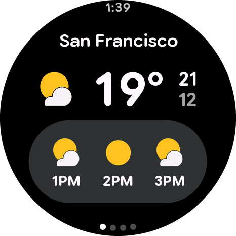 | 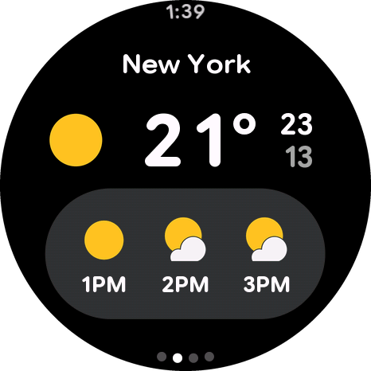 | 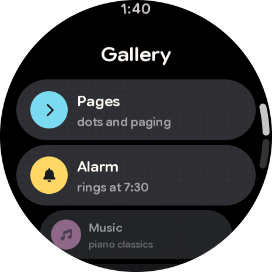 |
| **Конец галереи** | **Страницы** | **Плеер** | **Громкость** |
| 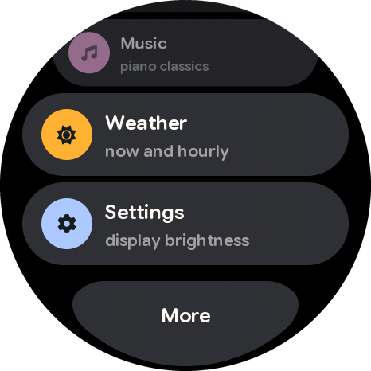 | 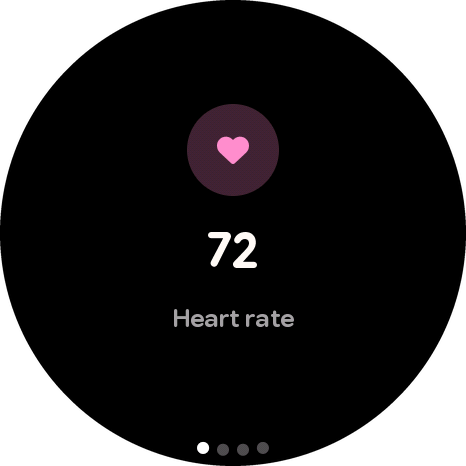 | 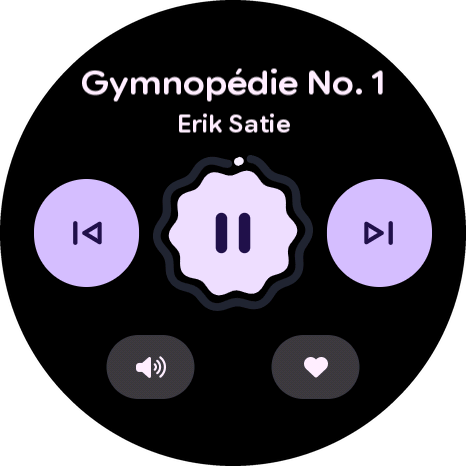 | 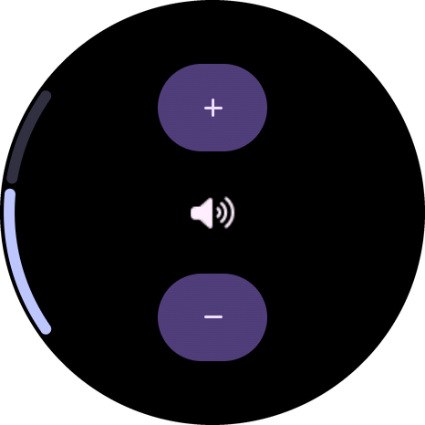 |
| **Настройки** | **Экран** | **Батарея** | **Блокировка** |
| 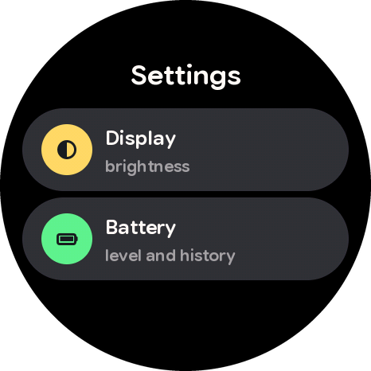 | 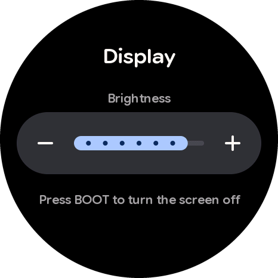 | 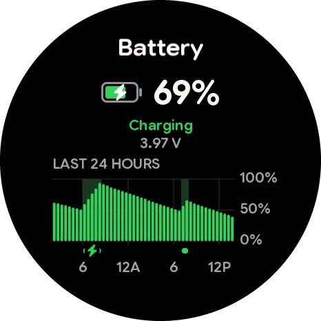 | 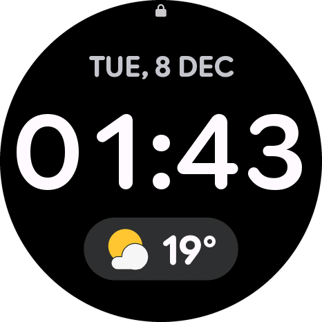 |
| **Always On** | | | |
| 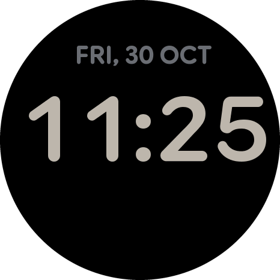 | | | |

## Что умеет

- **Циферблат**: цифры и буквы меняются прокруткой, как механический счётчик. Нажатие на плашку погоды открывает
  погоду.
- **Погода** по четырём городам, с точками страниц.
- **Галерея** карточек как на Pixel Watch: у краёв круга карточки уменьшаются, лента летит по инерции и упруго
  отскакивает; в конце — кнопка у края.
- **Переходы**: Fade между циферблатом и галереей, переход Android 16 внутрь экранов, свайп назад от левого края за
  пальцем.
- **Плеер** с настоящей музыкой (четыре отрывка по 20 секунд, без авторских прав), волнистой кнопкой и кольцом
  прогресса.
- **Настройки**: яркость ползунком (запоминается после перезагрузки) и экран батареи с графиком за сутки.
- **Always On**: через 15 секунд без касаний и движения экран плавно гаснет, и остаются только дата и часы
  циферблата, приглушённые, на чёрном. Плата засыпает и раз в минуту на мгновение просыпается сменить цифры (и
  сдвинуть их на несколько пикселей, чтобы AMOLED не выгорал). **Коснулся экрана, нажал BOOT или взял часы в руки** —
  сразу тот экран, где был, на полной яркости; само касание ничего не нажимает. На нашей батарее Always On за ночь
  потратил около **10 % за 8 часов** (100 % → 90 %).
- **Кнопки**: BOOT гасит экран совсем и усыпляет плату (будят касание, BOOT или подъём — подъём только после того, как
  плата полежала спокойно, поэтому выключенные в руке часы не проснутся от движения руки); PWR блокирует касания
  (сверху появляется замок), долгое нажатие — разблокировать.

Wi-Fi в этой версии нет, а отдельного чипа часов реального времени на плате нет (см. [Плата](#плата)), поэтому
часы стартуют со **случайных даты и
времени** и идут от них. Погода и числа здоровья — демонстрационные.

### Жесты

| Где | Жест | Что будет |
| --- | --- | --- |
| Циферблат | свайп вверх | галерея |
| Циферблат | нажать на плашку погоды | погода (назад — свайп вверх от нижнего края) |
| Галерея | свайп вниз от верхнего края | циферблат |
| Любой экран | свайп вправо от левого края | назад |
| Любой экран | свайп вверх от нижнего края | циферблат |
| Always On или тёмный экран | коснуться, нажать BOOT или взять в руки | сразу туда, где был |

## Плата

<p align="center">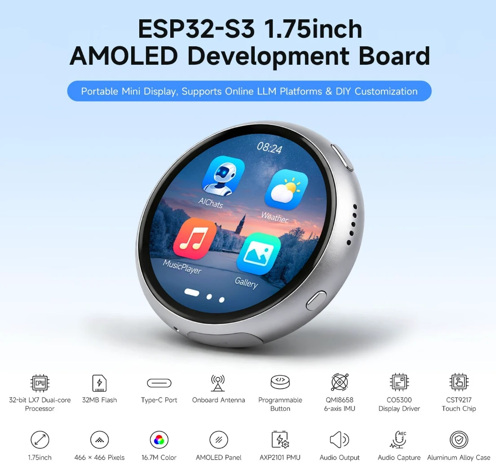<br><sub>Картинка: Waveshare</sub></p>

**[Waveshare ESP32-S3-Touch-AMOLED-1.75C](https://www.waveshare.com/esp32-s3-touch-amoled-1.75c.htm)** — маленькая
круглая плата для разработки в алюминиевом корпусе: сенсорный AMOLED-экран 1,75 дюйма, звук, датчик движения и
разъём для батареи. Документация — [docs.waveshare.com](https://docs.waveshare.com/ESP32-S3-Touch-AMOLED-1.75C),
примеры и схема — [GitHub](https://github.com/waveshareteam/ESP32-S3-Touch-AMOLED-1.75C).

| Что | Какое | В HaloWatch |
| --- | --- | --- |
| Процессор | ESP32-S3R8: два ядра Xtensa LX7 до 240 МГц, 512 КБ SRAM, 8 МБ PSRAM | оба ядра рисуют каждый кадр |
| Флеш | 32 МБ | прошивка и раздел для музыки |
| Радио | Wi-Fi 2,4 ГГц (802.11 b/g/n), Bluetooth 5 LE, антенна на плате | в этой версии не используется |
| Экран | AMOLED 1,75", 466 × 466, 16,7 млн цветов, 700 кд/м², драйвер CO5300 по QSPI, сигнал TE | свой драйвер |
| Тач | ёмкостный, CST9217 (I2C) | свой драйвер |
| Датчик движения | QMI8658, 6 осей: акселерометр и гироскоп | будит часы, когда их берут в руки (вывод «пробуждения по движению» INT1 идёт на GPIO21) |
| Питание | микросхема питания AXP2101, разъём для литиевой батареи 3,7 В (MX1.25), зарядка от USB | экран батареи, кнопка PWR |
| Звук | кодек ES8311 с динамиком; ES7210 с двумя микрофонами и подавлением эха | плеер (ES8311) |
| Кнопки | PWR и BOOT, обе программируемые | блокировка; выключение экрана и сон |
| USB | Type-C, собственный USB у ESP32-S3: прошивка и последовательный порт | прошивка, команды по USB |
| Корпус | цельный алюминий (фрезеровка), анодированный, отверстия для ремешка | — |

**Про RTC.** Во вступлении документации Waveshare упомянут RTC, но **отдельного чипа часов реального времени на
плате нет**. Его нет на [схеме](https://github.com/waveshareteam/ESP32-S3-Touch-AMOLED-1.75C/blob/main/hardware/schematic/ESP32-S3-Touch-AMOLED-1.75C-schematic.pdf), а скан шины I2C на плате находит только `0x18` ES8311, `0x34` AXP2101,
`0x40` ES7210, `0x5A` CST9217 и `0x6B` QMI8658 (и неизвестный `0x7E` — адрес, зарезервированный стандартом I2C), —
адресов часов вроде `0x51` или `0x68` нет. Время держит сам ESP32-S3 своим встроенным RTC-таймером, и только пока
есть питание; после выключения оно сбрасывается. Слота microSD тоже нет.

## Как это устроено

- **Рисуется только то, что изменилось.** Каждый элемент знает, где был и где стал; перерисовываются и уходят на
  экран только эти куски. Новая минута на циферблате — 1–2 % экрана, 1–4 мс.
- **Свой драйвер экрана.** Экран рисуется полосами по 16 строк. Пока одна полоса уходит по шине QSPI через DMA,
  следующая уже рисуется.
- **Оба ядра рисуют каждую полосу** — левую и правую половины, с подвижной границей, чтобы закончить одновременно.
- **Без разрывов.** Экран сообщает о каждом своём обновлении сигналом TE; лёгкий кадр уходит раньше прохода экрана,
  тяжёлый — сразу за ним.
- **Свой драйвер тача.** Тач-контроллер дёргает отдельный провод на каждый отчёт; задача читает его и считает
  скорость пальца — по ней лента летит дальше, а переход решает, закрыться ему или вернуться.
- **Ровное движение.** Время анимации — момент, когда экран покажет кадр (по сигналу TE, как Choreographer в
  Android), поэтому каждый кадр сдвигается на одинаковый шаг; а движущийся экран не переключается посреди движения
  между «раньше прохода экрана» и «за ним» — раньше это показывало кадр дважды или пропускало его.
- **Палец между отчётами.** Тач присылает отчёты ~100 раз в секунду, не в такт экрану на 60 Гц. Палец берётся в один
  и тот же момент перед показом каждого кадра, между двумя отчётами, как в Android: то, что под пальцем, едет ровными
  шагами (на настоящем пальце неровность шага — 0,56 px вместо 3,2 px).
- **Лёгкий сон.** Память и программа остаются, поэтому до картинки после пробуждения ~20–35 мс — без загрузки. Картинку
  Always On, пока процессор спит, AMOLED держит сам. Время во сне считает быстрый RC-генератор ÷ 256: медленный (по
  умолчанию) спешил на 0,5 % (полминуты за час сна), этот — 0,03–0,06 %.
- **Пружины как в Wear OS.** Жёсткость, затухание, длительности и то, как уменьшаются карточки у края, — из открытого
  кода Compose для Wear OS. Пружина считается точной формулой, поэтому отскок одинаковый при любой частоте кадров.

| Что | Кадр | Пропущено кадров |
| --- | --- | --- |
| Покой | кадров нет | — |
| Новая минута на циферблате | 1–4 мс | 0 |
| Листание страниц | медиана 3,3 мс | 0 |
| Прокрутка ленты карточек | медиана 9–11 мс | 0 |
| Плеер, пока играет музыка | медиана 5,7 мс | 0 |
| Always On | один кадр в минуту, остальное время — сон | — |

Бюджет кадра — 16,7 мс.

## Установка

### Готовый файл (проще всего)

Скачайте **`HaloWatch-v1.1-full.bin`** из [Releases](../../releases) — в нём прошивка и музыка. Запишите его на плату
по адресу **0x0**.

**В браузере** (Chrome или Edge, любая система): откройте [ESP Tool](https://espressif.github.io/esptool-js/),
подключите плату по USB, нажмите **Connect**, адрес — `0x0`, выберите файл и нажмите **Program**.

**Из командной строки** (macOS, Linux, Windows; нужен Python 3):

```bash
pip install esptool
esptool --chip esp32s3 write-flash 0x0 HaloWatch-v1.1-full.bin
```

esptool сам найдёт плату; если нет — добавьте `--port` с её портом: `/dev/cu.usbmodem101` на macOS, `/dev/ttyACM0`
на Linux, `COM5` на Windows. На Linux, возможно, сначала нужно добавить себя в группу `dialout`.

Если плата не подключается: зажмите **BOOT**, вставьте кабель, отпустите **BOOT** и попробуйте снова. После записи
нажмите **PWR** или переподключите кабель.

### Из исходников

Нужен [arduino-cli](https://arduino.github.io/arduino-cli/latest/installation/) (macOS: `brew install arduino-cli`)
и ядро ESP32 **3.3.11**:

```bash
arduino-cli config add board_manager.additional_urls https://espressif.github.io/arduino-esp32/package_esp32_index.json
arduino-cli core update-index
arduino-cli core install esp32:esp32@3.3.11
```

Собрать и прошить (порт — свой):

```bash
arduino-cli compile --upload -p /dev/cu.usbmodem101 --libraries libraries --fqbn "esp32:esp32:esp32s3:FlashSize=32M,PSRAM=opi,FlashMode=qio,PartitionScheme=app5M_fat24M_32MB,USBMode=hwcdc,CDCOnBoot=cdc" HaloWatch
```

Музыка для плеера записывается один раз, в свой раздел флеша (нужны `ffmpeg` и `esptool`):

```bash
python3 tools/halo_music.py HaloWatch --flash --port /dev/cu.usbmodem101
```

Свою музыку — так же: файл в `HaloWatch/assets/music/` (любой формат, который читает ffmpeg) и строка в
`HaloWatch/assets/music.conf`.

Шрифты, значки и картинки уже собраны в `HaloWatch/src/halo_assets.*`. Чтобы их поменять, правьте
`HaloWatch/assets/halo.conf` и запустите `python3 tools/halo_assets.py HaloWatch` (нужно `pip install numpy pillow`;
шрифты скачаются из своих репозиториев при первом запуске).

### Команды по USB

Прошивка слушает USB-порт (115200). Несколько команд: `face`, `face off`, `open 0`…`5`, `back`, `tap X Y`,
`swipe up|down|left|right [edge]`, `pwr`, `pwr long`, `boot`, `batdemo`, `log`, `sys`; Always On: `sleep`, `wake`,
`aod on|off`, `idle N` (секунды, 0 — никогда).

От USB часы по-настоящему не засыпают (порт бы замолчал, и плату нельзя было бы прошить): гаснут и просыпаются так
же, просто процессор продолжает работать. От батареи — спят по-настоящему. `usb on` — спать и от USB; тогда перед
прошивкой разбудите плату рукой.

## Что где

| Папка | Что там |
| --- | --- |
| `HaloWatch/` | Прошивка: `HaloWatch.ino` (галерея, страницы), `face.h`, `weather.h`, `player.h`, `music.h`, `settings.h`, `display.h`, `battery.h`, `power.h` (Always On и сон); `assets/` — исходники шрифтов, значков и музыки |
| `libraries/Halo/` | Библиотека Halo: драйверы экрана и тача, движок кадров, рисование, пружины, ленты, переходы экранов, звук, сон и пробуждение |
| `tools/` | `halo_assets.py` — шрифты, значки и картинки для Halo; `halo_music.py` — музыка для плеера |

## Версии

| Версия | Что нового |
| --- | --- |
| [1.1](../../releases/tag/v1.1) | Always On и сон (будят касание, BOOT или подъём часов), ровнее движение, плавнее ведение пальцем, BOOT усыпляет плату |
| [1.0](../../releases/tag/v1.0) | Первый релиз |

## Источники

**Интерфейс сделан по подобию Wear OS, только по открытым источникам.** Код написан с нуля. Прошивки и приложения
не вскрывались и не декомпилировались, кода из проектов под GPL нет. Числа движения и идеи взяты отсюда:

| Источник | Лицензия | Что взяли |
| --- | --- | --- |
| [androidx](https://github.com/androidx/androidx) — Compose для Wear OS | Apache 2.0 | жёсткость и затухание пружин, длительности и кривые, как уменьшаются карточки у края, свайп назад, индикаторы |
| [Horologist](https://github.com/google/horologist) | Apache 2.0 | плеер: размеры, волнистая кнопка, кольцо прогресса, тайминг анимаций значков |
| [wear-os-samples](https://github.com/android/wear-os-samples) | Apache 2.0 | как собирается экран из элементов |
| [PebbleOS](https://github.com/coredevices/PebbleOS) | Apache 2.0 | приёмы переходов экранов на микроконтроллере |
| [Material Design 3](https://m3.material.io) и гайды Wear OS | открытые руководства | общий стиль: цвета, скругления, размеры |

Чужие части в этом репозитории:

| Что | Автор | Лицензия |
| --- | --- | --- |
| Шрифт Google Sans Flex (буквы в `HaloWatch/src/halo_assets.cpp`) | Google | [SIL OFL 1.1](https://openfontlicense.org) |
| Значки Font Awesome Free (в `HaloWatch/src/halo_assets.cpp`) | Fonticons, Inc. | значки — [CC BY 4.0](https://fontawesome.com/license/free) |
| Последовательность регистров кодека ES8311 (`libraries/Halo/src/halo_audio.cpp`) | по драйверу es8311 от Espressif | Apache 2.0 |
| Пины платы и запуск экрана | по [примерам Waveshare](https://github.com/waveshareteam/ESP32-S3-Touch-AMOLED-1.75C) | Apache 2.0 |
| Картинка платы (`docs/board.webp`) | Waveshare, со [страницы товара](https://www.waveshare.com/esp32-s3-touch-amoled-1.75c.htm) | только чтобы показать плату |

Музыка — отрывки по 20 секунд из записей [Musopen](https://musopen.org) с Wikimedia Commons:

| Произведение | Исполнитель | Лицензия |
| --- | --- | --- |
| [Эрик Сати — Гимнопедия № 1](https://commons.wikimedia.org/wiki/File:Erik_Satie_-_gymnopedies_-_la_1_ere._lent_et_douloureux.ogg) | Robin Alciatore | общественное достояние |
| [И. С. Бах — «Гольдберг-вариации», Ария](https://commons.wikimedia.org/wiki/File:Bach,_Goldberg_Variations,_Aria_(Musopen_version).ogg) | Shelley Katz | CC0 1.0 |
| [Л. ван Бетховен — соната № 8 «Патетическая», II. Adagio cantabile](https://commons.wikimedia.org/wiki/File:Beethoven,_Sonata_No._8_in_C_Minor_Pathetique,_Op._13_-_II._Adagio_cantabile.ogg) | Paul Pitman | CC0 1.0 |
| [Ф. Шопен — Ноктюрн op. 15 № 1](https://commons.wikimedia.org/wiki/File:Chopin_-_Nocturne_Op._15_no._1_in_F_major.ogg) | Luke Faulkner | CC0 1.0 |

## Лицензия

Код этого репозитория — под лицензией **MIT** ([LICENSE](LICENSE)): его можно брать для чего угодно, в том числе в
коммерческие проекты. У чужих частей выше — свои лицензии, они остаются в силе.

Проект независимый: он не связан с Google, Espressif и Waveshare и не одобрен ими. Wear OS, Pixel Watch, Android и
Material Design — товарные знаки Google LLC; ESP32 — товарный знак Espressif Systems; Waveshare — товарный знак Waveshare Electronics; названия упоминаются только
чтобы объяснить, на что похож интерфейс и на чём он работает.
